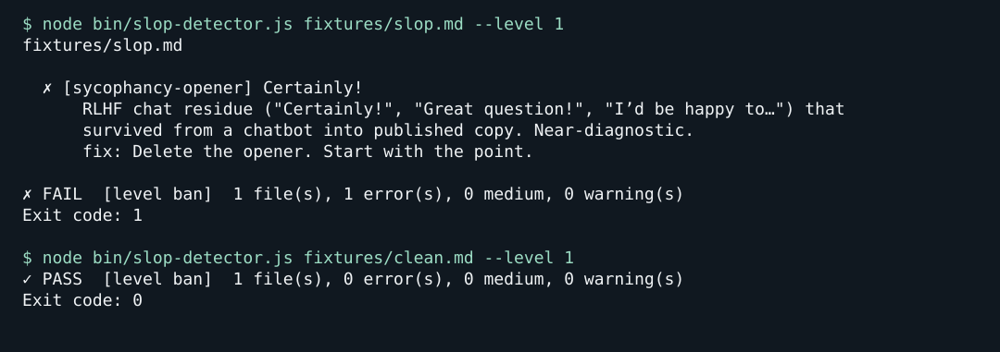
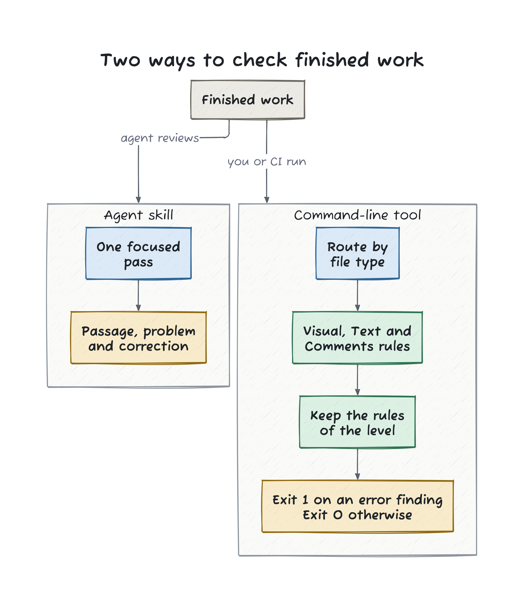

# ai-slop-detector

[](https://github.com/asabirov/ai-slop-detector-skill/actions/workflows/tests.yml) [](https://github.com/asabirov/ai-slop-detector-skill/releases) [](LICENSE)

An agent skill and optional command-line linter that help developers review prose, interfaces, and code comments for empty claims and distracting presentation.



## Why it exists, and what it turned down

AI-assisted drafts can keep chatbot greetings, vague claims, and comments that only describe the code.

| Option | Outcome | Reason |
| --- | --- | --- |
| Scan after every edit | Turned down | The skill makes one pass over finished work |
| Ban a style in all cases | Turned down | Safety comments and intentional native UI fonts stay acceptable |
| Decide who wrote the work | Turned down | Neither tool can prove it |

## Design



| Choice | What it means |
| --- | --- |
| Skill for judgment | It reports the passage, the reader's problem and a specific correction |
| Tool for repeatable patterns | It checks many files and gives stable exit codes for CI |
| Skill acts on finished work | It runs before a pull request or other delivery, and skips routine chat replies |
| Skill stays in scope | It never runs a command or reviews untouched files on its own |
| Level 1 is the merge gate | Higher levels are polish |
| No npm package | `npx` installs from this repository, so the runner needs network access to GitHub |
| `.js`, `.mjs`, `.cjs`, `.ts`, `.mts` and `.cts` files skip the visual rules by default | The output counts the skipped files. To check interface copy, add `--as artifact`. The code is then read as prose, which can cause false positives |

| Rule pack | Reads | Finds |
| --- | --- | --- |
| Visual | Markup and the CSS a page applies | Fake protocol URIs, decorative monospace, emoji headings |
| Visual | Same | Gradients, glow shadows, nested cards, oversized stats |
| Visual | Same | Multi-word buttons, repeated field captions, duplicate status badges |
| Visual | Same | An explanatory line under or beside a table or chart |
| Text | Visible prose, and attributes such as `title`, `alt` and `placeholder` | "Not just X, but Y", sycophancy, clusters of inflated words |
| Text | Same | A reply that repeats the message before it |
| Comments | Source files | Design documents written into code comments |

Each level adds rules to the one below.

| `--level` | Name | Use |
| --- | --- | --- |
| `1` | `ban` | Merge gate |
| `2` | `recommended` | Default, polish |
| `3` | `strict` | Polish |
| `4` | `paranoid` | Polish |

| Exit code | Meaning |
| --- | --- |
| `0` | No error finding |
| `1` | At least one error finding |
| `2` | Bad arguments, or no file matched |

## How to run and verify it

Install the latest version:

```sh
DO_NOT_TRACK=1 npx skills add https://github.com/asabirov/ai-slop-detector-skill --skill ai-slop-detector --agent claude-code codex --global
```

Update it later:

```sh
DO_NOT_TRACK=1 npx skills update ai-slop-detector --global
```

`DO_NOT_TRACK=1` turns off the telemetry of the skills CLI. The CLI needs Node.js, npm and Git.

`DO_NOT_TRACK=1` stops the skills tool from sending telemetry. The installer puts the skill in `~/.agents/skills/ai-slop-detector` and links it into `~/.claude/skills`. Then ask the agent: "check this README for AI slop".

| Dependency | Needed for |
| --- | --- |
| Node.js 22.20.0 or newer | The installer, skills 1.9.0 |
| Node.js 20 or newer | The detector |
| npm | The installer and `npx` runs from a tag |
| Git | The installer and `npx` runs from a tag |
| Network access to GitHub | The installer and `npx` runs from a tag |

To run the installed tool:

```bash
node ~/.agents/skills/ai-slop-detector/bin/slop-detector.js <path>
```

To try the tool with no install, run this. The first scan fails on purpose, because the sample holds a chatbot greeting. Replace the sample path with a file or directory to scan your own work.

```bash
REPO=github:asabirov/ai-slop-detector-skill
printf 'Great question! Here is the summary.\n' > slop.md
printf 'The build takes four minutes.\n' > clean.md
npx -y "$REPO#v2.12.0" slop.md --level 1
npx -y "$REPO#v2.12.0" clean.md --level 1
```

```text
slop.md

  ✗ [sycophancy-opener] Great question!
      RLHF chat residue ("Certainly!", "Great question!", "I’d be happy to…") that survived from a chatbot into published copy. Near-diagnostic.
      fix: Delete the opener. Start with the point.

✗ FAIL  [level ban]  1 file(s), 1 error(s), 0 medium, 0 warning(s)
✓ PASS  [level ban]  1 file(s), 0 error(s), 0 medium, 0 warning(s)
```

The first scan exits **1** and the second exits **0**.

In CI, pin a release tag. An unpinned run follows `main`, and a rule that gets stricter can fail a build that passed yesterday.

```bash
REPO=github:asabirov/ai-slop-detector-skill
npx -y "$REPO#v2.12.0" src scripts --level 1
npx -y "$REPO#v2.12.0" 'src/**/*.js' --json
```

| Task | Command |
| --- | --- |
| Update or roll back | The [releases page](https://github.com/asabirov/ai-slop-detector-skill/releases) lists the newest tag |
| Remove the skill | `DO_NOT_TRACK=1 npx skills remove ai-slop-detector --agent claude-code codex --global` |
| Run the unit tests and fixtures | `npm test` |
| Run the detector on its own code | `npm run lint:self` |
| Run both, as CI does | `npm run verify` |
| Draw the demo image again | `python3 docs/render-demo.py > assets/demo.svg` |

To change a rule, open an issue that names the rule id and shows the case.

License: [MIT](LICENSE).
