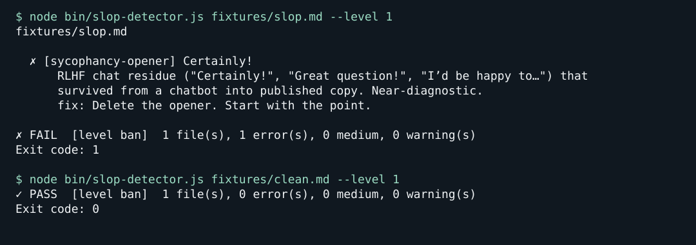

# ai-slop-detector

An agent skill and optional command-line linter that help developers review prose, interfaces, and code comments for empty claims and distracting presentation.

This project combines editorial judgment with deterministic checks. It does not require scans after every edit or ban certain styles unconditionally: necessary safety comments and intentional native UI fonts should remain acceptable during review.



The image shows actual output from the synthetic fixtures below. Regenerate it
with `python3 docs/render-demo.py > assets/demo.svg` (Python 3 and Node required).

## Quick start

Requires Node.js 20+ and Git. No dependency installation is needed for a local scan.

```bash
git clone https://github.com/asabirov/ai-slop-detector-skill.git
cd ai-slop-detector-skill
node bin/slop-detector.js fixtures/slop.md --level 1
node bin/slop-detector.js fixtures/clean.md --level 1
```

The first scan reports `sycophancy-opener` and exits **1**. That failure is expected:
it catches a chatbot greeting in the sample. The second scan reports `PASS` and
exits **0**. Replace the fixture path with a file or directory to scan your work.

The CLI is **not published to npm**. The public registry returned 404 for
`@apliteni/slop-detector` on 2026-09-23. Run from this clone or use the GitHub-based `npx` commands under [Running it](#running-it).

## Why it exists

AI-assisted drafts can keep chatbot greetings, vague claims, and comments that simply describe the code. The skill identifies specific problems in a finished artifact. The optional CLI finds repeatable patterns across files and provides stable exit codes for CI. Neither tool can prove who wrote the work.

## Install, update, roll back, and remove

Install the tagged skill for Claude Code and Codex with:

```bash
DO_NOT_TRACK=1 npx skills add https://github.com/asabirov/ai-slop-detector-skill/tree/v2.7.0 --skill ai-slop-detector --agent claude-code codex --global
```

`DO_NOT_TRACK=1` tells the skills CLI not to send telemetry. The `npx skills`
installer requires Node.js/npm and Git. It puts the skill in
`~/.agents/skills/ai-slop-detector`, where Codex reads it, and links it into
`~/.claude/skills` for Claude Code.

The skill itself needs nothing else. The optional CLI needs Node.js 20+ and
comes with the install, so you can run it from there:

```bash
node ~/.agents/skills/ai-slop-detector/bin/slop-detector.js <path>
```

Update to a later release tag with the same command and its new tag. Roll back
by rerunning it with the previous release tag. The newest tag is on the
[releases page](https://github.com/asabirov/ai-slop-detector-skill/releases).
Remove it with:

```bash
DO_NOT_TRACK=1 npx skills remove ai-slop-detector --agent claude-code codex --global
```

If you prefer not to use `npx skills`, clone the repository at the `v2.7.0` release tag into your agent's skills folder as `ai-slop-detector`. To update or roll back, run `git fetch --tags` in that folder and check out another release tag; to remove it, delete the folder.

Versions are the `vX.Y.Z` release tags that the release workflow creates; the skill has no version field of its own.
After each release the same workflow opens a pull request that renames every tag in this file to the newest release,
because `main` takes no push. Until the owner merges it, the tags here name the last release whose pull request was
merged. The workflow retries on the next merge to `main`, so a release whose pull request never opened is not lost.

## Using the skill

The skill's description asks the agent to check its work before opening a pull
request, sending a review page, or delivering other finished work, without
waiting for an explicit request. Routine chat replies are left out. You can also ask it
to “check this README for AI slop”. The skill makes one focused pass and reports
the passage, the reader's problem and a specific correction. It preserves useful technical
detail and does not rewrite for readability; use a separate editing pass for that.

The editorial UI checks cover headline full stops, middot separators, repeated
qualification badges, unhelpful implementation captions, a heading, label or legend
that repeats a nearby value or mark, a control that holds a choice but is named for its job, the same fact stated twice, an
explanation wrapped around a changing number, a footnote under a table, a lede or
subtitle beside the heading that names one, and tooltip text set as its own line, in rendered pages and interface copy files. They preserve necessary
disclosures and useful user
information. Component style mismatches need a rendered comparison; uncertain
ones are reported as needing a design review. These are agent review instructions, not additional
CLI rules.

The editorial checks also report unnecessary status distinctions and manual
commands on automatic features. They ask which distinctions matter and whether
the system can act instead. Status counts alone do not decide a finding.
Required manual recovery and controls for consent or user decisions remain
acceptable. Both checks address the examples in [issue #91](https://github.com/asabirov/ai-slop-detector-skill/issues/91).

For unclear marketing lines, the skill can run a fresh-reader check
(see [SKILL.md](SKILL.md)); the CLI does not.

Read [SKILL.md](SKILL.md) for the workflow. The skill does not automatically run a
command, install dependencies or review untouched files. Use the CLI when
requested, required by the repository or useful for a batch scan. Editorial
judgment does not waive an existing CI gate.

## What it does today

Three rule packs over one engine. The text parser approximates what a browser displays.

Every prose stream a rule reads — a page's visible runs, its prose, its
paragraphs, its readable attributes, and the same for markdown and plain text —
decodes semicolon-terminated character references, including every HTML5 name and both
numeric forms. So a dotted chain written `&middot;` and one typed with the dot are
the same line. Numeric C1 references use HTML's replacement glyphs, so `&#149;`
reads as `•` and `&#146;` reads as `’`. The scans that read markup for class
names, selectors and tag shapes work on the page as written.
Standalone CSS keeps character references literal. HTML decodes references in
style attributes before the visual rules read them. Quoted attribute data,
including `>`, stays outside visible prose. Readable attributes have separate
prose streams. Each HTML token scan moves forward through comments, tags, and
raw text for its consumer. A quoted closing tag inside an attribute cannot end
hidden script or code content. A trailing slash inside an unquoted attribute
value stays part of that value. It cannot close the element.
A slash flag cannot close a known non-void HTML element. Foreign elements and unknown component names retain self-closing syntax.
Component files, including JSX and TSX, also keep self-closing native tags. Namespace lookups use recorded stack positions.
HTML paragraph starts leave foreign content. An HTML encoding on MathML `annotation-xml` supplies an HTML integration point.
Markdown prose keeps references literal after an odd number of backslashes,
even when the file contains raw HTML. References after an even number decode.
Markdown prose accepts 1 to 7 decimal digits or 1 to 6 hexadecimal digits.
Longer references stay literal in Markdown prose. Inside raw HTML blocks,
HTML decodes them without these Markdown limits. The parser also reads
human-readable attributes in raw HTML, including single-quoted values.
Raw HTML in Markdown still supplies markup and CSS to visual rules. Inline
`<style>` contents count, while commented or fenced styles do not. Inline HTML
keeps its text, so numeric table cells retain the monospace exemption.
The simple Markdown link scanner skips unfinished suffixes without repeated
searches. Lazy list continuations keep their owners without copying the complete stack.
Tests measure public parse growth for unfinished links, raw HTML, and lazy lists.
These checks do not establish a bound for every possible input. Markdown
syntax is removed before references are decoded, so
an encoded bracket cannot turn visible text into a link destination.
The parser excludes script, style, and code
contents from Markdown prose. Autolinks and literal angle-bracket text remain
visible to text rules. A comment marker inside a quoted HTML attribute stays
attribute data. A raw HTML comment can end with `--!>`.
When Markdown escapes that sequence, the comment stays open.
Textarea content keeps tag and comment spellings as text.
Raw HTML blocks can start after completed headings and fences. Script, style,
and textarea state stays active across a Markdown block boundary. A list-shaped
line inside an active fence or raw HTML block keeps that block open. A raw HTML
region ends when its list item ends. The parser determines Markdown leaf blocks
before it reads inline comments, tags, and code spans. Sibling list items end
separate inline blocks, including items numbered `2.` or `02.`.
Blank paragraphs end inline comment candidates, including blank lines inside lists and quotes.
A new ordered list interrupts an open paragraph only with content and a start
value of one, including `01.`. An empty marker cannot interrupt a paragraph.
A line without its list indentation or quote marker can continue a paragraph.
Such a lazy line keeps its list owner. A setext underline must belong to that
owner and retain the quote markers. An unindented `===` stays paragraph text
inside a list. An ATX or setext heading ends its inline block before the next
paragraph starts. A fence treats extra quote markers as content after it removes
its owning container prefix. Fence indentation expands tabs at source columns
before it removes that prefix. Five spaces after a list marker leave four
spaces of code indentation. Short `<!-->` and
`<!--->` comments end before later code spans. Backticks in tags and comments
do not open code spans. In raw HTML blocks, script and style closing tags can
contain quoted `>` characters, attributes, or a trailing slash. A quote inside
an unquoted attribute value stays data and does not hide the next `>`.
This also applies after an equals sign inside that value.
A rejected Markdown closing candidate cannot consume a nested valid close.
Inline raw closes accept a form-feed separator. Vertical tab and nonbreaking space are not
closing-tag separators. The text parser remains approximate for malformed HTML
tags across a blank line and unfinished tags at the end of a file. Malformed
HTML nesting also remains approximate. Some raw HTML block closers with a
different tag name remain a known limit. An unclosed `pre` block can stay hidden
after a list or quote ends.


<details>
<summary>Raw HTML recovery examples</summary>

These examples compare `5180d6a` with the repair in this README. Both versions ran the real CLI with `--level 1`.

Blank paragraphs end inline comment candidates. A quote after an equals sign inside an unquoted value stays data.

HTML script, style, and code elements remain open after a slash flag. The detector excludes code content by policy.

`fixtures/slop-html-paragraph.md`

```markdown
Read <!-- hidden

↗ -->
```

```diff
--- 5180d6a: fixtures/slop-html-paragraph.md
+++ repair: fixtures/slop-html-paragraph.md
@@ -1 +1,10 @@
-✓ PASS  [level ban]  1 file(s), 0 error(s), 0 medium, 0 warning(s)
+
+fixtures/slop-html-paragraph.md
+
+  ✗ [external-link-arrow] Read <!-- hidden
+
+↗ -->
+      Diagonal "↗" open-in-new-tab arrow tacked onto a link — decorative external-link cosplay. A link already reads as a link.
+      fix: Drop the glyph. Plain directional →←↑↓ (flows, deltas) are fine.
+
+✗ FAIL  [level ban]  1 file(s), 1 error(s), 0 medium, 0 warning(s)
```

`fixtures/slop-html-recovery.html`

```html
<script a=b="c>const label="x";</script><p>shown ↗</p>
```

```diff
--- 5180d6a: fixtures/slop-html-recovery.html
+++ repair: fixtures/slop-html-recovery.html
@@ -1 +1,8 @@
-✓ PASS  [level ban]  1 file(s), 0 error(s), 0 medium, 0 warning(s)
+
+fixtures/slop-html-recovery.html
+
+  ✗ [external-link-arrow] shown ↗
+      Diagonal "↗" open-in-new-tab arrow tacked onto a link — decorative external-link cosplay. A link already reads as a link.
+      fix: Drop the glyph. Plain directional →←↑↓ (flows, deltas) are fine.
+
+✗ FAIL  [level ban]  1 file(s), 1 error(s), 0 medium, 0 warning(s)
```

`fixtures/slop-html-slash.html`

```html
<script/>const a="↗";</script>
<code data-path=/assets/ />hidden ↗</code>
<style/>p{font-family:monospace}</style><p>Hello</p>
```

```diff
--- 5180d6a: fixtures/slop-html-slash.html
+++ repair: fixtures/slop-html-slash.html
@@ -4,3 +4,3 @@
-  ✗ [external-link-arrow] const a="↗"; hidden ↗ p{font-family:mon
-      Diagonal "↗" open-in-new-tab arrow tacked onto a link — decorative external-link cosplay. A link already reads as a link.
-      fix: Drop the glyph. Plain directional →←↑↓ (flows, deltas) are fine.
+  ✗ [mono-noncode] p → <p> · monospace
+      Monospace font on an element that is not code — fake-terminal decoration. Real code gets mono; a metadata line does not.
+      fix: Use a readable proportional font, or put the content in a <code>/<pre> if it really is code. If you want a label to stand out, weight or size it — do not costume it as code. Numeric table data may use monospace or font-variant-numeric: tabular-nums.
@@ -8,5 +8 @@
-  ✗ [external-link-arrow] const a="↗"; hidden ↗ p{font-family:monospace} Hel
-      Diagonal "↗" open-in-new-tab arrow tacked onto a link — decorative external-link cosplay. A link already reads as a link.
-      fix: Drop the glyph. Plain directional →←↑↓ (flows, deltas) are fine.
-
-✗ FAIL  [level ban]  1 file(s), 2 error(s), 0 medium, 0 warning(s)
+✗ FAIL  [level ban]  1 file(s), 1 error(s), 0 medium, 0 warning(s)
```

`fixtures/slop-html-slash.md`

```markdown
<style/>p{font-family:monospace}</style><p>Hello</p>
```

```diff
--- 5180d6a: fixtures/slop-html-slash.md
+++ repair: fixtures/slop-html-slash.md
@@ -1 +1,8 @@
-✓ PASS  [level ban]  1 file(s), 0 error(s), 0 medium, 0 warning(s)
+
+fixtures/slop-html-slash.md
+
+  ✗ [mono-noncode] p → <p> · monospace
+      Monospace font on an element that is not code — fake-terminal decoration. Real code gets mono; a metadata line does not.
+      fix: Use a readable proportional font, or put the content in a <code>/<pre> if it really is code. If you want a label to stand out, weight or size it — do not costume it as code. Numeric table data may use monospace or font-variant-numeric: tabular-nums.
+
+✗ FAIL  [level ban]  1 file(s), 1 error(s), 0 medium, 0 warning(s)
```

The following similar controls produced identical output before and after.

`inputs/paragraph-control.md`

```markdown
Read <!-- hidden
↗ -->
```

```text
✓ PASS  [level ban]  1 file(s), 0 error(s), 0 medium, 0 warning(s)
```

`inputs/script-control.html`

```html
<script>const a="↗";</script><p>Hello.</p>
```

```text
✓ PASS  [level ban]  1 file(s), 0 error(s), 0 medium, 0 warning(s)
```

`inputs/code-control.html`

```html
<code data-path=/assets/>shown ↗
```

```text
✓ PASS  [level ban]  1 file(s), 0 error(s), 0 medium, 0 warning(s)
```

`inputs/style-control.html`

```html
<style>p{font-family:monospace}</style><p>Hello</p>
```

```text

inputs/style-control.html

  ✗ [mono-noncode] p → <p> · monospace
      Monospace font on an element that is not code — fake-terminal decoration. Real code gets mono; a metadata line does not.
      fix: Use a readable proportional font, or put the content in a <code>/<pre> if it really is code. If you want a label to stand out, weight or size it — do not costume it as code. Numeric table data may use monospace or font-variant-numeric: tabular-nums.

✗ FAIL  [level ban]  1 file(s), 1 error(s), 0 medium, 0 warning(s)
```

`inputs/opening-control.html`

```html
<script a="b=c">const label="x";</script><p>shown ↗</p>
```

```text

inputs/opening-control.html

  ✗ [external-link-arrow] shown ↗
      Diagonal "↗" open-in-new-tab arrow tacked onto a link — decorative external-link cosplay. A link already reads as a link.
      fix: Drop the glyph. Plain directional →←↑↓ (flows, deltas) are fine.

✗ FAIL  [level ban]  1 file(s), 1 error(s), 0 medium, 0 warning(s)
```

The following namespace correction compares `5b7de1a` with the repair, also at `--level 1`.
HTML paragraph starts leave foreign content. MathML `annotation-xml` with an HTML encoding supplies HTML content.
These transitions keep later text inside an unclosed HTML script.

`fixtures/slop-html-namespace.md`

```markdown
<svg><p><script/>hidden ↗</script></p></svg>  <math><p><script/>hidden ↗</script></p></math>  <math><annotation-xml encoding="text/html"><script/>hidden ↗</script></annotation-xml></math>  Visible ↗
```

```diff
--- 5b7de1a: fixtures/slop-html-namespace.md
+++ repair: fixtures/slop-html-namespace.md
@@ -4 +4 @@
-  ✗ [external-link-arrow] hidden ↗        hidden ↗        hidde
+  ✗ [external-link-arrow] Visible ↗
@@ -8,13 +8 @@
-  ✗ [external-link-arrow] hidden ↗        hidden ↗        hidden ↗     Visible
-      Diagonal "↗" open-in-new-tab arrow tacked onto a link — decorative external-link cosplay. A link already reads as a link.
-      fix: Drop the glyph. Plain directional →←↑↓ (flows, deltas) are fine.
-
-  ✗ [external-link-arrow] hidden ↗        hidden ↗     Visible ↗
-      Diagonal "↗" open-in-new-tab arrow tacked onto a link — decorative external-link cosplay. A link already reads as a link.
-      fix: Drop the glyph. Plain directional →←↑↓ (flows, deltas) are fine.
-
-  ✗ [external-link-arrow] ↗        hidden ↗     Visible ↗
-      Diagonal "↗" open-in-new-tab arrow tacked onto a link — decorative external-link cosplay. A link already reads as a link.
-      fix: Drop the glyph. Plain directional →←↑↓ (flows, deltas) are fine.
-
-✗ FAIL  [level ban]  1 file(s), 4 error(s), 0 medium, 0 warning(s)
+✗ FAIL  [level ban]  1 file(s), 1 error(s), 0 medium, 0 warning(s)
```

The foreign-script control produced identical output before and after.

`inputs/foreign-control.md`

```markdown
<svg><script/></svg><p>shown ↗</p>
```

```text

inputs/foreign-control.md

  ✗ [external-link-arrow] shown ↗
      Diagonal "↗" open-in-new-tab arrow tacked onto a link — decorative external-link cosplay. A link already reads as a link.
      fix: Drop the glyph. Plain directional →←↑↓ (flows, deltas) are fine.

✗ FAIL  [level ban]  1 file(s), 1 error(s), 0 medium, 0 warning(s)
```

</details>

In markup, `p`, `div`, headings, `span`, `li`, table cells, `section`, `header`,
`footer`, `text`, `a`, `dl`, `dt`, `dd`, and `br` end a visible text run. This keeps
definition values separate. Other tags stay in the surrounding run, so inline
`svg` and `label` content can still complete a chain. This split does not use
CSS layout or a DOM, so it can differ from browser text boundaries. Files not
read as markup use the earlier boundary list, without `dl`, `dt`, `dd`, or `br`.
The boundary names must match complete tags, so `dt-label` and `dd-value` stay inline.

- **Visual** reads markup and the CSS a page applies, including stylesheets it
  links from disk. Catches fake protocol URIs, monospace used as decoration,
  emoji headings, gradients, glow shadows, glass surfaces, nested cards,
  oversized stats, motion and repeated layout defaults. It also reads position:
  an explanatory line under a table or a chart — the basis of the numbers, what
  they exclude, where they came from, or an "as of" date — fails at level 1,
  whether or not a local design rule asks for the line — and so does a lede, group
  subtitle or "as of" line set beside the heading that names it. A component counts
  as a table: `<DataTable/>` and `<LineChart/>` are what a screen actually ships.
  Native font stacks, numeric table data, a count line, a chart legend, a caption
  naming its figure, and a total, unit, byline or control beside a heading are
  allowed.
- **Text** reads visible prose plus the attributes a person actually reads
  (`title`, `alt`, `placeholder`, `aria-label`, `data-tip`, the meta
  description). Catches "not just X, but Y", hedge openers, sycophancy residue,
  clustered inflated vocabulary.
- **Comments** reads source files. Catches the design document an agent files
  into a code comment because the project gave it nowhere else to write one.
  `comment-chaptered` joins blocks separated by exactly one blank line, with
  no code between them: 8+ comment lines require two headings or interior
  dividers in total to fail level 1. A block of 8+ lines with one signal
  still fails on its own, even inside a joined run.
  One title in a joined run is a label; two chapter signals make chapters.
  Blank separators do not count toward length; individual block frames stay
  exempt. Essay and ratio measurements are unchanged.

Code is not prose. In Markdown regions, fenced blocks, indented code blocks,
and inline code spans come out before decoration rules read them. Raw HTML blocks and
readable HTML attributes keep backticks as text. Spans use matching runs of N
backticks, and the HTML sniff runs after Markdown code removal. A Markdown
file that names `<style>` in a code span stays Markdown. An escaped backtick
stays visible, and a fenced block inside a blockquote stays code.

Four levels, each a superset of the one below: `ban`, `recommended` (default),
`strict`, `paranoid`. Only `error` findings exit non-zero, so level 1 is the
merge gate and the higher levels are polish.

[The CLI reference](docs/ai-slop-detector.md) documents coverage and thresholds.
[SKILL.md](SKILL.md) is the personal skill entrypoint.

## Running it

In a repository's CI, or anywhere with Node 20:

```bash
REPO=github:asabirov/ai-slop-detector-skill
npx -y "$REPO#v2.7.0" dist --level 1        # pin a tag in CI
npx -y "$REPO#v2.7.0" src scripts --level 1
npx -y "$REPO" 'src/**/*.js' --json         # unpinned tracks main
```

There is no npm package. `npx` installs from this repository, so a runner needs
network and access to GitHub. Pin a tag: unpinned tracks `main`, and a rule that
tightens will fail a build that passed yesterday. The tag above is the one the
release workflow last put here, which lags while its pull request waits; the
newest is on the [releases page](https://github.com/asabirov/ai-slop-detector-skill/releases).

In this repository:

```bash
npm test           # the unit tests, the fixtures, and this repo's own prose
npm run lint:self  # the detector must pass its own rules
npm run verify     # both, in that order — the one script CI runs
```

`main` requires a `test` check, and that check runs `npm run verify`, so a pull
request whose unit tests fail cannot merge. The release workflow reports its own
`test` status on the README branch it opens, from the same script, so the two
mean the same thing. Paste the full `npm run verify` output into the PR anyway:
the check says pass or fail and nothing about which assertions ran. CodeQL runs
alongside it.

Every test has a budget — its own `{ timeout: ms }` or the module's default —
and the suites take `test`, `it` and `describe` from `scripts/lib/budget.js`,
which times each body on top of the timeout it hands to `node:test`. Without
that a synchronous test runs as long as it likes: a timeout cannot interrupt
code that never yields the thread.

JavaScript and TypeScript source files skip visual rules by default. Text output
reports how many files skipped them, including in mixed scans; JSON marks each
file with `visualRulesSkipped`. Rerun UI copy with `--as artifact` to include
those checks; code is then read as prose,
which can produce false positives. CSS and component files such as `.tsx`
already receive visual checks and do not get the skip notice.

The UI rules use static markup and declaration heuristics rather than a browser
or CSS engine: no runtime dependencies, fast batch scans, and no computed-style
claims. They read standalone CSS, inline styles, and literal Tailwind classes in
HTML, JSX, TSX, Vue, Svelte, and Astro. Dynamic classes, Tailwind configuration,
CSS cascade resolution, and contrast checks need a rendered review. See the
[CLI reference](docs/ai-slop-detector.md) for coverage and thresholds.

`nested-cards` counts a `card`, `panel`, or `tile` class only when an applied
declaration gives the element a border, background, or box shadow. A rounded
element with one of those styles also counts, even without a card-like class.
The rule expands the side values in `border-width`, `border-style`, and
`border-color` across CSS whitespace outside color functions. An omitted
`border-width` uses the initial medium width when a visible style is set.
The rule checks border styles outside color functions, so a missing color
channel does not disable a solid border. It ignores transparent color tokens,
nonpainting background shorthands with numeric positions, sizes, and empty
layers. This includes `50% 50% transparent`, `center / 100% 100% transparent`,
and `none, none transparent`. It recognizes unsigned decimal zero alpha in
RGB, HSL, HWB, Lab, LCH, OKLab, OKLCH, and `color()` values. Signed zero,
exponent forms, and missing alpha channels remain outside this check.
It checks shadow lengths outside balanced
color functions and ignores shadows with zero geometry. Complex color
expressions remain painted when their final alpha is unknown.
Class names alone do not establish a painted card.
This static check cannot resolve inherited styles, complex selectors, later
cascade resets, or dynamic classes. Review those cases in the rendered page.

## Changing a rule

The rule set is a shared contract. Do not fork it, and do not silence a rule in
the repository that trips over it. Open an issue here naming the rule `id`,
showing the case, and saying what you would change.

A CLI rule change is tested both ways: a triggering case goes into a slop
fixture, and every `fixtures/clean.*` must stay silent at paranoid. If a new
rule makes a clean fixture fire, the rule is wrong, not the fixture.

A change to what the skill flags also ships examples in its pull request: one
case whose result changes, one that reads the same both times, and a diff of
the check's real output before and after. A CLI rule has a fixture to run. An
editorial rule has none, so the two runs are the review itself, once against
each version of the rule text. Two runs may differ on their own; say so when a
line moves for that reason. `AGENTS.md` has the full rule.

## License

[MIT](LICENSE).
